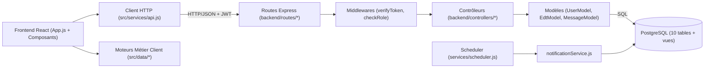
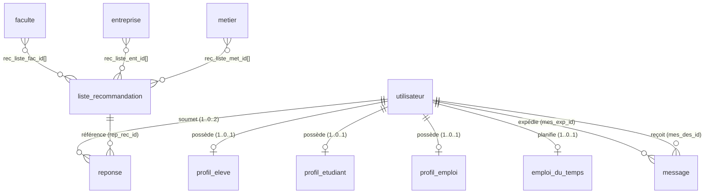
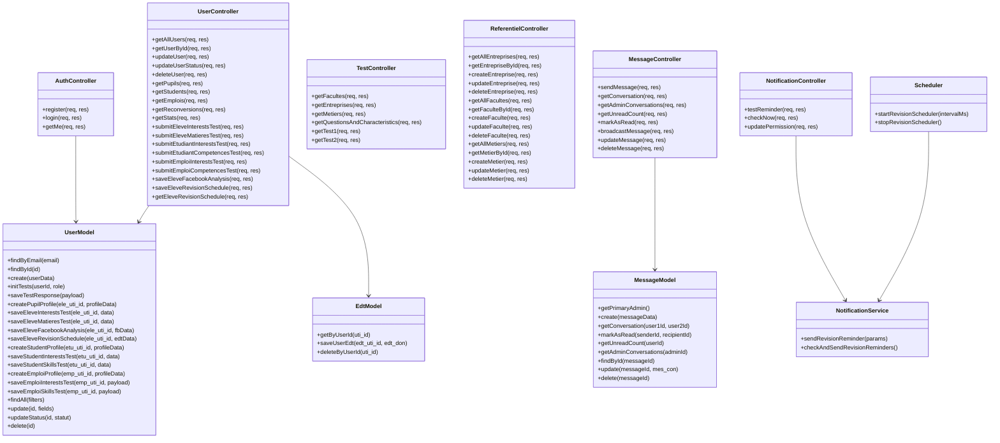

# Conception & Rétro-Ingénierie — Plateforme **e-HARI**
*(Habiletés, Accompagnement, Réussite et Insertion — ONG HARI Madagascar)*

---

## 1. Architecture Générale

L'application **e-HARI** repose sur une architecture client-serveur découplée :

- **Backend (`D:\HARI\projet\backend`)** : API REST Node.js / Express (`index.js`, port `5000`), connectée à une base relationnelle **PostgreSQL 15+** via `pg` (`config/db.js`). Authentification par **JWT** (`jsonwebtoken`) et hachage de mots de passe (`bcryptjs`). Un planificateur périodique (`services/scheduler.js`) déclenche l'envoi d'e-mails de rappel de révision (`nodemailer` dans `services/notificationService.js`).
- **Frontend (`D:\HARI\projet\frontend`)** : Single Page Application **React** (`src/App.js`) communiquant avec le backend via un client centralisé (`src/services/api.js`) et embarquant des moteurs de calcul d'orientation et de planification côté client (`src/data/`).

---

## 2. Modèle de Données (PostgreSQL) — Entités, Attributs & Relations

La base de données s'articule autour de **10 tables** (9 tables fondamentales dans `database/schema.sql` + `message` issue de `database/migration_create_messages_table.js`) et de **4 vues de compatibilité**.

### 2.1 Diagramme Entité-Relation

### 2.2 Description des Tables et Attributs

#### `utilisateur` (Préfixe `uti_`)
Table centrale des comptes et de l'authentification.
- **Clé primaire** : `uti_id` (`SERIAL`)
- **Attributs** :
  - `uti_nom` (`VARCHAR(100) NOT NULL`)
  - `uti_pre` (`VARCHAR(100) NOT NULL`)
  - `uti_ema` (`VARCHAR(150) UNIQUE NOT NULL`)
  - `uti_pas` (`VARCHAR(255) NOT NULL` — hash bcrypt)
  - `uti_rol` (`VARCHAR(20) NOT NULL` — `'admin' | 'eleve' | 'etudiant' | 'emploi' | 'reconversion'`)
  - `uti_tel` (`VARCHAR(30)`)
  - `uti_adr` (`TEXT`)
  - `uti_ava` (`TEXT` — URL / DataURL avatar)
  - `uti_sta` (`VARCHAR(20)` — `'actif' | 'inactif' | 'suspendu'`, défaut `'actif'`)
  - `uti_dat_cre`, `uti_dat_mod` (`TIMESTAMPTZ`)

#### `profil_eleve` (Préfixe `ele_`) — Relation 1:1 avec `utilisateur`
- **Clé primaire** : `ele_id` (`SERIAL`)
- **Clé étrangère** : `ele_uti_id` (`INTEGER UNIQUE NOT NULL REFERENCES utilisateur(uti_id) ON DELETE CASCADE`)
- **Attributs** : `ele_cla` (`VARCHAR(50)`), `ele_ser` (`VARCHAR(100)`), `ele_eta` (`VARCHAR(150)`), `ele_not_ema` (`BOOLEAN DEFAULT TRUE`), `ele_dat_cre`, `ele_dat_mod`.

#### `profil_etudiant` (Préfixe `etu_`) — Relation 1:1 avec `utilisateur`
- **Clé primaire** : `etu_id` (`SERIAL`)
- **Clé étrangère** : `etu_uti_id` (`INTEGER UNIQUE NOT NULL REFERENCES utilisateur(uti_id) ON DELETE CASCADE`)
- **Attributs** : `etu_eta` (`VARCHAR(150)`), `etu_fil` (`VARCHAR(150)`), `etu_niv_etu` (`VARCHAR(50)`), `etu_dat_cre`, `etu_dat_mod`.

#### `profil_emploi` (Préfixe `emp_`) — Relation 1:1 avec `utilisateur`
- **Clé primaire** : `emp_id` (`SERIAL`)
- **Clé étrangère** : `emp_uti_id` (`INTEGER UNIQUE NOT NULL REFERENCES utilisateur(uti_id) ON DELETE CASCADE`)
- **Attributs** : `emp_sit_act` (`VARCHAR(150)`), `emp_met_act` (`VARCHAR(150)`), `emp_dat_cre`, `emp_dat_mod`.
- **Vue associée** : `profils_reconversion` (`rec_id`, `rec_uti_id`, `rec_sit_act`, `rec_met_act`, ...).

#### `emploi_du_temps` (Préfixe `edt_`) — Relation 1:1 avec `utilisateur`
- **Clé primaire** : `edt_id` (`SERIAL`)
- **Clé étrangère** : `edt_uti_id` (`INTEGER UNIQUE NOT NULL REFERENCES utilisateur(uti_id) ON DELETE CASCADE`)
- **Attributs** : `edt_don` (`JSONB NOT NULL DEFAULT '{}'` — grille hebdomadaire 5h–21h + créneaux de révision générés + `chosenTrack`), `edt_dat_cre`, `edt_dat_mod`.

#### `reponse` (Préfixe `rep_`) — Relation N:1 avec `utilisateur` et N:1 avec `liste_recommandation`
Centralise les réponses et résultats des tests (Test 1 et Test 2) pour tous les profils.
- **Clé primaire** : `rep_id` (`SERIAL`)
- **Clés étrangères** :
  - `rep_uti_id` (`INTEGER NOT NULL REFERENCES utilisateur(uti_id) ON DELETE CASCADE`)
  - `rep_rec_id` (`INTEGER REFERENCES liste_recommandation(rec_id) ON DELETE SET NULL`)
- **Contrainte d'unicité** : `UNIQUE (rep_uti_id, rep_rol, rep_test_num)`
- **Attributs** : `rep_rol` (`'eleve' | 'etudiant' | 'emploi' | 'reconversion'`), `rep_test_num` (`SMALLINT IN (1, 2)`), `rep_choix` (`TEXT`), `rep_resultat` (`VARCHAR(255)`), `rep_pt_sci` (`INTEGER`), `rep_pt_lit` (`INTEGER`), `rep_detail` (`JSONB`), `rep_dat_cre`, `rep_dat_mod`.
- **Vues associées** : `tests_eleves`, `tests_etudiants`, `tests_emploi`.

#### `liste_recommandation` (Préfixe `rec_`)
- **Clé primaire** : `rec_id` (`SERIAL`)
- **Attributs** : `rec_liste_fac_id` (`INTEGER[]`), `rec_liste_ent_id` (`INTEGER[]`), `rec_liste_met_id` (`INTEGER[]`).

#### Référentiels d'orientation (`faculte`, `entreprise`, `metier`)
- **`faculte` (`fac_`)** : `fac_id`, `fac_nom`, `fac_sigle`, `fac_type`, `fac_ville`, `fac_filiere` (`TEXT[]`), `fac_description`, `fac_site_web`, `fac_pole`, `fac_dat_cre`.
- **`entreprise` (`ent_`)** : `ent_id`, `ent_nom`, `ent_secteur`, `ent_secteur_detail`, `ent_ville`, `ent_implantation`, `ent_description`, `ent_poste_recrute` (`TEXT[]`), `ent_profil_recherche`, `ent_accessibilite`, `ent_email_contact`, `ent_site_web`, `ent_pole`, `ent_dat_cre`.
- **`metier` (`met_`)** : `met_id`, `met_nom`, `met_secteur`, `met_niveau_requis`, `met_salaire_indicatif`, `met_description`, `met_debouche` (`TEXT[]`), `met_pole`, `met_dat_cre`.

#### `message` (Préfixe `mes_`) — Messagerie privée (MP)
- **Clé primaire** : `mes_id` (`SERIAL`)
- **Clés étrangères** : `mes_exp_id` (`REFERENCES utilisateur(uti_id)`), `mes_des_id` (`REFERENCES utilisateur(uti_id)`)
- **Attributs** : `mes_con` (`TEXT`), `mes_fic_nom`, `mes_fic_typ`, `mes_fic_tai`, `mes_fic_url`, `mes_lu` (`BOOLEAN DEFAULT FALSE`), `mes_dat_cre`.

---

## 3. Conception Orientée Objet & Classes / Modules Backend

### 3.1 Diagramme de Classes (Couches Modèles, Contrôleurs & Services)

### 3.2 Middlewares & Sécurité (`backend/middlewares/`)
- **`authMiddleware.js`** :
  - `verifyToken(req, res, next)` : extrait le JWT du header `Authorization: Bearer <token>`, vérifie sa validité et injecte `req.user` (`uti_id`, `uti_rol`, `uti_ema`).
  - `checkRole(...roles)` : contrôle l'accès RBAC selon `req.user.uti_rol` (`admin`, `eleve`, `etudiant`, `emploi`, `reconversion`).
- **`errorHandler.js`** : middleware global de capture et formatage JSON des erreurs HTTP.

### 3.3 Points d'Entrée API REST (`backend/routes/`)

| Préfixe | Routeur | Endpoints principaux |
|---|---|---|
| `/api/auth` | `authRoutes.js` | `POST /register`, `POST /login`, `GET /me` |
| `/api/users` (`/api/utilisateurs`) | `userRoutes.js` | `GET /`, `GET /stats`, `GET /eleves`, `GET /etudiants`, `GET /emploi`, `GET /:id`, `PUT /:id`, `PATCH /:id/statut`, `DELETE /:id`, `POST /eleve/test-interets`, `POST /eleve/test-matieres`, `POST /eleve/edt`, `GET /eleve/edt`, `POST /etudiant/test-interets`, `POST /etudiant/test-competences`, `POST /emploi/test-interets`, `POST /emploi/test-competences` |
| `/api/tests` | `testRoutes.js` | `GET /facultes`, `GET /entreprises`, `GET /metiers`, `GET /test-1`, `GET /test-2`, `GET /:role/:testNumber` |
| `/api/referentiel` (`/api`) | `referentielRoutes.js` | CRUD complet `/entreprises`, `/facultes` (alias `/fecultes`), `/metiers` (lecture publique, écriture `admin`) |
| `/api/messages` (`/api/messagerie`) | `messageRoutes.js` | `POST /`, `GET /conversation/:userId?`, `GET /admin/conversations`, `GET /unread-count`, `POST /mark-read/:userId`, `POST /broadcast`, `PUT /:id`, `DELETE /:id` |
| `/api/notifications` | `notificationRoutes.js` | `POST /test-reminder` (alias `/test-rappel`), `POST /permission` (`PATCH`), `POST /check-now` |
| `/api/health` | `index.js` | Vérification Express + PostgreSQL |

---

## 4. Architecture Frontend (`frontend/src/`)

### 4.1 Service API Client (`src/services/api.js`)
Objet singleton `api` encapsulant `fetch` avec injection automatique du token JWT (`localStorage.getItem('token')`) et gestion de session (`localStorage.getItem('user')`).

- **Authentification** : `login()`, `register()`, `getMe()`, `logout()`, `getCurrentUser()`
- **Utilisateurs & Admin** : `getUsers()`, `getUserStats()`, `updateUser()`, `updateUserStatus()`, `deleteUser()`, `getPupils()`, `getStudents()`, `getEmplois()`, `getReconversions()`
- **Référentiels CRUD** : `getEntreprises()`, `getEntreprise()`, `createEntreprise()`, `updateEntreprise()`, `deleteEntreprise()`, `getFacultes()`, `getFaculte()`, `createFaculte()`, `updateFaculte()`, `deleteFaculte()`, `getMetiers()`, `getMetier()`, `createMetier()`, `updateMetier()`, `deleteMetier()`
- **Tests & EDT** : `submitEleveInterestsTest()`, `submitEleveMatieresTest()`, `submitEtudiantInterestsTest()`, `submitEtudiantCompetencesTest()`, `submitEmploiInterestsTest()`, `submitReconversionInterestsTest()`, `submitEmploiCompetencesTest()`, `submitReconversionCompetencesTest()`, `getTestQuestions()`, `getTest1()`, `getTest2()`, `saveEleveEdt()`, `getEleveEdt()`
- **Notifications & Messagerie** : `testRevisionReminder()`, `updateNotificationPermission()`, `sendMessage()`, `getConversation()`, `getAdminConversations()`, `getUnreadMessagesCount()`, `markConversationAsRead()`, `broadcastMessage()`, `updateMessage()`, `deleteMessage()`
- **Utilitaires** : `get()`, `post()`, `checkHealth()`

### 4.2 Composants React (`src/components/`)

| Composant | Rôle & Responsabilité |
|---|---|
| `App.js` | Orchestrateur principal : page d'accueil carrousel, modales Auth (Connexion / Inscription + Google UI), sidebar par rôle (`admin`, `eleve`, `etudiant`, `emploi`/`reconversion`), notifications toast auto-fermantes, profils et routage de vues |
| `OrientationBriefingView.js` | Bilan d'orientation scolaire unifié de l'élève (cohérence série Bac, études supérieures, métiers, synergie, forums) |
| `RevisionScheduleView.js` | Grille interactive EDT 5h–21h, génération automatique des créneaux de révision, gestion des rappels e-mail |
| `StudentCareerBriefingView.js` | Bilan d'orientation universitaire et insertion pour le profil `etudiant` |
| `StudentInsertionView.js` | Suivi et outils d'insertion professionnelle pour les étudiants |
| `ReconversionCareerBriefingView.js` | Bilan d'orientation et de reconversion / emploi pour le profil `emploi` |
| `SecteursRecrutementMadaView.js` | Explorateur des secteurs porteurs et recruteurs à Madagascar |
| `CvLetterBuilderView.js` | Générateur de CV et lettre de motivation |
| `MessengerChatView.js` | Messagerie privée style Messenger (conversations, pièces jointes, diffusion admin, édition/suppression) |
| `AdminEntreprisesView.js` | Interface CRUD Admin pour les entreprises partenaires |
| `AdminFacultesView.js` | Interface CRUD Admin pour les facultés et universités |
| `AdminMetiersView.js` | Interface CRUD Admin pour les métiers et fiches carrières |
| `UserHistogramChart.js` | Graphiques statistiques d'évolution et répartition des utilisateurs (Admin) |
| `PersonalityAvatar.js`, `ModernTestIcon.js`, `ModernChartIcons.js`, `NavIcons.js`, `HariLogo.js` | Composants graphiques SVG vectoriels (avatars de personnalité, icônes QCM, icônes navigation, emblèmes ONG HARI) |

### 4.3 Moteurs Métier & Données Statiques (`src/data/`)
- `orientationTests.js` / `studentOrientationTests.js` / `reconversionOrientationTests.js` : définitions des QCM Test 1 & Test 2 et fonctions de scoring (`computeOrientation1`, `computeOrientation2`, `computeStudentOrientation1`, `computeStudentOrientation2`, `computeReconversionOrientation1`, `computeReconversionOrientation2`).
- `orientationBriefing.js` / `studentCareerBriefing.js` / `reconversionCareerBriefing.js` : générateurs de synthèses personnalisées croisant Test 1, Test 2, classe/série et profil.
- `revisionScheduleEngine.js` : analyse de la grille hebdomadaire (`5h–21h`), détection des temps libres et génération des tâches de révision (`analyzeAndGenerateFromWeeklyGrid`, `detectStudentContradictionOrDivergence`).
- `madagascarSeries.js` & `secteursRecrutementMadaData.js` : référentiels des séries du Baccalauréat malgache et des secteurs économiques à Madagascar.
